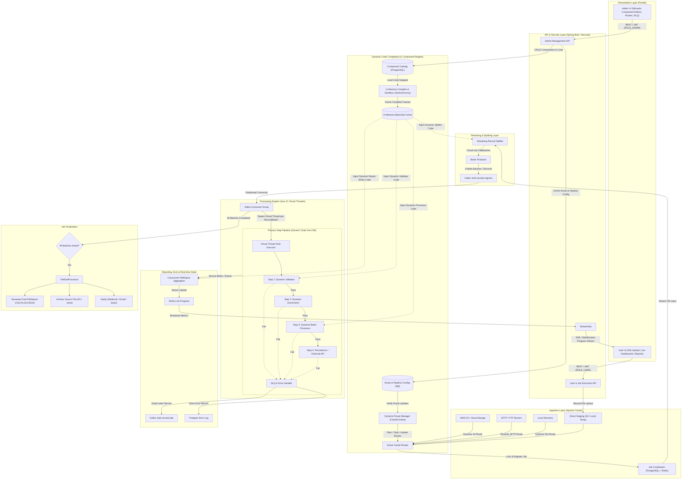

# Distributed Bulk Processing Engine - Comprehensive Implementation Plan

## 1. Executive Summary & Core Objectives

The **Bulk Processing Engine** is a high-performance, fault-tolerant, and dynamically configurable data processing platform designed to ingest, validate, process, and report on large-scale datasets. While starting with CSV file processing, the platform is architected around generic interfaces and pluggable abstractions to seamlessly accommodate future formats (e.g., Parquet, JSON Lines, XML, Fixed-Width) and varied protocols (AWS S3, SFTP, HTTP Webhooks, GCP Cloud Storage, Azure Blob).

**Crucially, all configurations—including file routes, record splitters, validators, batch processors, report writers, and post-processing lifecycle hooks—are persisted in the database and fully manageable at runtime via dedicated user interfaces. Administrators can configure both declarative parameters and write custom execution code directly from the Admin UI using guided wizards or individual component editors without requiring application restarts or code deployments.**

### Core Goals
- **Dual Portal User Experience**:
  - **Admin UI**: Complete operational control—configure routes, manage credentials, visually construct process steps, tune batch sizes, inspect Dead Letter Queues (DLQ), monitor worker health, and write/edit custom code for splitters, validators, batch processors, and report writers.
  - **User UI**: End-user and operator interface—drag-and-drop manual file uploads, trigger bulk jobs, monitor live progress via real-time streams (SSE/WebSockets), view error diagnostics, and download execution reports.
- **In-UI Programmable Components & Guided Wizards**:
  - **Guided Wizards**: Step-by-step setup flows for creating new instances of Splitters, Validators, Batch Processors, and Report Writers, as well as an end-to-end Pipeline Assembly Wizard.
  - **Individual Component Editors**: Direct, granular editing of standalone component instances with integrated Monaco code editor, pre-flight test sandboxes, version diffing, and one-click rollbacks.
  - **Dynamic In-Memory Bytecode Compilation**: Custom Java/Groovy code written in the Admin UI is compiled directly into JVM bytecode in microseconds (via Janino / Groovy) and executed at native speed within Java 21 Virtual Threads under strict security sandboxing.
- **Dynamic Database-Driven Configurations**: All Camel routes, splitters, pipeline steps, and hooks are stored in PostgreSQL and loaded/reloaded dynamically into runtime memory and the Apache Camel context.
- **High Concurrency & Throughput**: Scale to process hundreds of thousands to millions of records concurrently with sub-second per-record latency leveraging Java 21 Project Loom Virtual Threads.
- **Constant Memory Footprint (O(1))**: Stream and chunk records directly from input sources to prevent out-of-memory (`OOM`) errors regardless of file size (multi-gigabyte files).
- **Extensible & Generic Architecture**: Strong foundation using Java 21 generics and clean interface-driven design, decoupling input sources, parsing logic, processing steps, and reporting sinks.
- **Resilience & Fault Tolerance**: Granular retry policies, circuit breakers, dead-letter queue (DLQ) routing, transaction checkpoints, and idempotent processing.

---

## 2. Technology Stack & Runtime Specifications

| Layer / Component | Technology | Rationale & Configuration |
| :--- | :--- | :--- |
| **Runtime & Language** | **Java 21 (LTS)** | Project Loom Virtual Threads (`Executors.newVirtualThreadPerTaskExecutor()`), Pattern Matching, Records, Scoped Values. |
| **Application Framework** | **Spring Boot 3.3+ / 3.4+** | Spring Boot Starters, Actuator, Native Virtual Thread support (`spring.threads.virtual.enabled=true`), Spring Security (JWT + RBAC). |
| **Dynamic In-Memory Compiler & Sandbox** | **Janino & Groovy 4 Compiler / JSR-223** | Ultra-fast in-memory Java/Groovy bytecode compilation with near-native JVM execution speeds. AST-based security sandbox restricting prohibited classes (`System`, `Runtime`, `File`, `reflect`). |
| **Distributed Orchestration** | **Spring Cloud** | Spring Cloud OpenFeign / LoadBalancer, Cloud Config (optional), Consul/Eureka/K8s service discovery. |
| **Integration & Routing** | **Apache Camel 4.x (Camel Spring Boot)** | Enterprise Integration Patterns (EIP), dynamic route creation/removal at runtime via `ModelCamelContext` and `RouteController`. |
| **Message Broker** | **Apache Kafka (Event Streaming)** | Partitioned message streaming for decoupling file ingestion, batch dispatching, worker concurrency, and event notifications. |
| **Relational Storage (SQL)** | **PostgreSQL 16+** | Dynamic route configs, component instance registry, code payloads, pipeline step definitions, job execution metadata, Flyway migrations. |
| **High-Speed Cache / NoSQL** | **Redis 7+ & MongoDB / ClickHouse** | **Redis**: Distributed locking (Redlock), deduplication keys, atomic counters, real-time job progress tracking.<br>**NoSQL (Optional/Analytical)**: Raw ingested audit logs, high-throughput error logs, and analytical aggregations. |
| **Frontend Applications** | **React 18/19, TypeScript, Vite, Tailwind CSS, shadcn/ui** | Fast, responsive modern SPAs for Admin UI and User UI; TanStack Query (React Query) for state; Lucide icons. |
| **Web Code Editor** | **Monaco Editor (VS Code engine)** | Integrated in Admin UI for syntax highlighting, autocomplete, linting, and formatting for Java/Groovy code snippets. |
| **Real-Time Communication** | **Server-Sent Events (SSE) / STOMP WebSockets** | Push-based real-time progress bars, throughput meters, and live job status updates from backend to UI. |
| **Container & Orchestration** | **Docker Compose & Kubernetes** | Complete local reproducible dev environment via Docker Compose; Helm charts for production K8s deployment. |
| **Observability & Metrics** | **Micrometer, Prometheus, Grafana, OpenTelemetry** | Distributed tracing across file-to-record boundaries, queue lag tracking, throughput metrics (records/sec), JVM virtual thread monitoring. |

---

## 3. High-Level Architecture & Data Flow



---

## 4. UI Architecture & Portal Specifications

The system provides two distinct user interfaces, built using **React 19, TypeScript, Vite, Tailwind CSS, and shadcn/ui**, sharing a unified design system, Monaco code editor, and reusable component library.

### 4.1. Admin UI (Operational & Configuration Center)

The Admin UI empowers system administrators and engineers to configure both declarative options and **write custom executable code** for Splitters, Validators, Batch Processors, and Report Writers. It provides both **guided multi-step wizards** (for streamlined creation) and **individual standalone editors** (for direct, granular modifications).

#### 4.1.1. Programmable Component Instances Catalog (`/admin/components`)
A centralized registry managing reusable, versioned instances of the four core processing pillars:
- **Splitter Instances**: Streaming chunkers, delimiter extractors, multi-line handlers, custom CSV parsing scripts.
- **Validator Instances**: Schema verifiers, cross-field dependency checkers, business rule scripts.
- **Batch Processor Instances**: Field mappers, data enrichers, calculation scripts, database batch writers.
- **Report Writer Instances**: Summary KPI aggregators, custom CSV/Excel/JSON export formatters.

Each instance displays its active version, status, language (`JAVA`, `GROOVY`, `DECLARATIVE`), and a list of active pipelines referencing it.

#### 4.1.2. Component Setup Wizard (`/admin/components/wizard`)
A guided 5-step wizard for configuring new component instances:
1. **Step 1: Component Type Selection**: Select between `Record Splitter`, `Record Validator`, `Batch Processor`, or `Report Writer`.
2. **Step 2: Implementation Mode**:
   - **Declarative Form Mode**: Intuitive UI forms (regex patterns, field rules, delimiter dropdowns, SpEL conditions, arithmetic transformations, target table mappings) translated to JSON schema without code.
   - **Code Snippet / Script Mode**: Full programmable logic in Java or Groovy using Monaco Editor with starter template, autocompletion, imports, and helper SDK utilities.
   - **Hybrid Mode**: Declarative baseline configuration + custom code hook (e.g. standard CSV splitter + custom row filter script; standard validator + custom cross-field validation script).
3. **Step 3: Editor & Sandbox Workspace**:
   - Integrated **Monaco Editor** with Java/Groovy syntax highlighting, code formatting, and autocomplete.
   - Access to standard execution context APIs (`JobContext`, `RecordItem`, `logger`).
4. **Step 4: Pre-Flight Sandbox Test Harness**:
   - Input test payload area (paste sample CSV row, JSON record, or batch array).
   - "Run Sandbox Test" button: Compiles the script in a transient sandbox and runs it on the sample input.
   - Live output viewer: Execution time in microseconds ($\mu s$), transformed record structure, validation error messages, or logs.
5. **Step 5: Review & Version Deployment**:
   - Define instance name, identifier (e.g. `customer-kyc-validator-v1`), tags, and changelog description.
   - "Deploy Instance" writes to PostgreSQL and primes the in-memory bytecode cache.

#### 4.1.3. Individual Component Instance Editor (`/admin/components/:id`)
A dedicated, full-screen workbench for direct, rapid modifications by experienced developers without having to step through the wizard:
- **Split-Screen IDE**: Monaco code editor on the left; live test harness and parameter inspector on the right.
- **Version History & Diff Viewer**: Side-by-side graphical diff (Version $N$ vs Version $N-1$) highlighting changed code and configuration keys.
- **Dependency Impact Analysis**: Displays an alert banner listing all active pipelines utilizing this component instance, with confirmation checks before applying breaking changes.
- **One-Click Instant Rollback**: Revert to any historical version with a single click, instantly evicting and updating the runtime bytecode cache.

#### 4.1.4. End-to-End Pipeline Assembly Wizard (`/admin/pipelines/wizard`)
A 6-step guided wizard allowing operators to assemble a complete bulk ingestion pipeline from scratch:
1. **Route Setup**: Select an existing route or define a new file route (S3, SFTP, Local, Webhook).
2. **Splitter Selection**: Choose a registered Splitter instance (e.g. `UnivocityCsvSplitter` or custom script splitter).
3. **Validation Chain**: Add one or more Validator instances, define sequence order, and select fail strategies (`CONTINUE_ON_ERROR`, `STOP_JOB`).
4. **Processing Chain**: Add one or more Batch Processor instances (transformations, external enrichments, SQL upserts), and set batch size (e.g. 1,000 records).
5. **Report Writer Selection**: Select a Report Writer instance to define how successful and failed rows are summarized and exported.
6. **Lifecycle Hooks**: Configure post-processing actions (Webhook notification, S3 archival, Slack alert).

#### 4.1.5. Route Management Studio (`/admin/routes`)
- **Route Catalog**: List all active, paused, and draft file routes.
- **Route Builder Form**: Protocol selector (AWS S3, Local Directory, SFTP/FTP, HTTP Inbound), endpoint URI, bucket name, directory path, credentials (securely masked, stored with AES-GCM encryption in DB).
- **Pre-flight Connection Tester**: "Test Connection" button that validates S3 credentials or SFTP handshake before saving.
- **Runtime Route Actions**: Start, Pause, Resume, Reload, or Delete routes dynamically in Apache Camel with zero downtime.

#### 4.1.6. Dead Letter Queue (DLQ) & Error Console (`/admin/dlq`)
- Search and inspect failed records grouped by job, error code, or timestamp.
- View raw payload, failed step name, and stack trace.
- **Bulk Replay / Resubmit**: Select failed records, edit payload if needed, and re-inject them into the Kafka ingress topic.

#### 4.1.7. Configuration Audit Log (`/admin/audit`)
- Track every change made to components, routes, pipelines, or credentials with admin user ID, timestamp, and JSON diff.

---

### 4.2. User UI (Operator & End-User Portal)

The User UI provides an intuitive, high-velocity dashboard for business users, operators, and data analysts to run jobs and track results.

#### Key Features & Views
1. **Manual Ingestion & Upload Center (`/user/upload`)**:
   - Drag-and-drop CSV file uploader supporting multi-gigabyte uploads (direct-to-S3 pre-signed URL or chunked multipart upload).
   - Pipeline selector dropdown (select which configured process should handle the file).
   - Pre-validation preview: Instantly inspects the first 10 rows and validates column headers against the selected pipeline schema before initiating processing.
   - "Start Processing" trigger button.
2. **Live Execution Dashboard (`/user/dashboard`)**:
   - Real-time active job cards with animated progress bars (0%–100%).
   - Live metrics streamed via Server-Sent Events (SSE):
     - Records Processed / Total Estimated Records.
     - Instantaneous Throughput (e.g., `4,250 records/sec`).
     - Success Count vs. Failed Count ratio.
     - Estimated Time Remaining (ETA).
   - Job control actions: Pause, Resume, or Cancel ongoing bulk job.
3. **Execution History & Reports Hub (`/user/jobs`)**:
   - Comprehensive searchable and filterable table of past jobs (filter by status, date range, process type, file name).
   - Summary statistics: duration, total volume, error percentage.
   - One-click **Report Download**:
     - Executive Summary Report (`.csv` or `.xlsx`).
     - Failed Records Report containing row numbers and exact error descriptions.
4. **Drill-Down Error Inspector (`/user/jobs/:id/errors`)**:
   - Interactive table of rejected rows.
   - Human-friendly error messages (e.g., *"Row 1420: Column 'email' is invalid: 'john@' is not a valid email"*).
   - Option to download an "Erroneous Rows Only" CSV file for offline correction and re-upload.

---

## 5. Database-Driven Dynamic Configuration & Runtime Route Management

All configurations reside in PostgreSQL and are loaded dynamically into the application and Apache Camel context.

### 5.1. Database Configuration Schemas

```sql
-- 1. Programmable Component Instances Catalog (Splitters, Validators, Processors, Writers)
CREATE TABLE component_instance (
    instance_id VARCHAR(64) PRIMARY KEY,
    component_type VARCHAR(32) NOT NULL, -- SPLITTER, VALIDATOR, BATCH_PROCESSOR, REPORT_WRITER
    name VARCHAR(128) NOT NULL,
    description TEXT,
    execution_mode VARCHAR(32) NOT NULL, -- DECLARATIVE_WIZARD, CODE_SNIPPET, HYBRID
    language VARCHAR(32) NOT NULL DEFAULT 'JAVA', -- JAVA, GROOVY, SPEL, DECLARATIVE
    source_code TEXT,                    -- User-written code snippet from Monaco Editor
    declarative_config JSONB,            -- Form parameters if using wizard/declarative mode
    input_schema JSONB,                  -- Expected input record fields and data types
    output_schema JSONB,                 -- Produced output fields / types
    sample_test_payload TEXT,            -- Sample test input preserved for sandbox runs
    version INT NOT NULL DEFAULT 1,
    is_active BOOLEAN NOT NULL DEFAULT TRUE,
    created_by VARCHAR(64),
    created_at TIMESTAMP WITH TIME ZONE DEFAULT CURRENT_TIMESTAMP,
    updated_at TIMESTAMP WITH TIME ZONE DEFAULT CURRENT_TIMESTAMP
);

-- 2. Component Version History (Audit, Diffs & Rollbacks)
CREATE TABLE component_instance_version (
    version_id BIGSERIAL PRIMARY KEY,
    instance_id VARCHAR(64) NOT NULL REFERENCES component_instance(instance_id) ON DELETE CASCADE,
    version INT NOT NULL,
    source_code TEXT,
    declarative_config JSONB,
    changelog TEXT,
    created_by VARCHAR(64),
    created_at TIMESTAMP WITH TIME ZONE DEFAULT CURRENT_TIMESTAMP
);
CREATE UNIQUE INDEX idx_comp_ver ON component_instance_version(instance_id, version);

-- 3. Dynamic File Route Configuration
CREATE TABLE route_config (
    route_id VARCHAR(64) PRIMARY KEY,
    route_name VARCHAR(128) NOT NULL,
    route_type VARCHAR(32) NOT NULL,     -- S3, FILE, SFTP, HTTP_INBOUND
    endpoint_uri VARCHAR(512) NOT NULL,
    processed_uri VARCHAR(512),
    error_uri VARCHAR(512),
    cron_expression VARCHAR(64),
    polling_interval_ms INT DEFAULT 5000,
    credentials_encrypted JSONB,          -- AES-GCM encrypted credentials (keys, passwords)
    parameters JSONB,                     -- Extra Camel options (delete=true, maxMessagesPerPoll=10)
    process_id VARCHAR(64) NOT NULL,      -- Associated pipeline process
    status VARCHAR(32) NOT NULL DEFAULT 'ACTIVE', -- ACTIVE, PAUSED, DRAFT
    version INT NOT NULL DEFAULT 1,
    created_by VARCHAR(64),
    updated_at TIMESTAMP WITH TIME ZONE DEFAULT CURRENT_TIMESTAMP
);

-- 4. Process Pipeline Definition (Assembled from Components)
CREATE TABLE process_definition (
    process_id VARCHAR(64) PRIMARY KEY,
    name VARCHAR(128) NOT NULL,
    description TEXT,
    input_format VARCHAR(32) NOT NULL DEFAULT 'CSV',
    splitter_instance_id VARCHAR(64) REFERENCES component_instance(instance_id), -- Selected Splitter Instance
    report_writer_instance_id VARCHAR(64) REFERENCES component_instance(instance_id), -- Selected Report Writer Instance
    concurrency_config JSONB NOT NULL,    -- maxConcurrentBatches, virtualThreadsEnabled, batchChunkSize
    is_active BOOLEAN NOT NULL DEFAULT TRUE,
    version INT NOT NULL DEFAULT 1,
    created_at TIMESTAMP WITH TIME ZONE DEFAULT CURRENT_TIMESTAMP,
    updated_at TIMESTAMP WITH TIME ZONE DEFAULT CURRENT_TIMESTAMP
);

-- 5. Configurable Process Steps (Validation & Processing Chain)
CREATE TABLE process_step_config (
    step_id VARCHAR(64) PRIMARY KEY,
    process_id VARCHAR(64) REFERENCES process_definition(process_id) ON DELETE CASCADE,
    component_instance_id VARCHAR(64) REFERENCES component_instance(instance_id), -- Selected Validator/Processor Instance
    step_name VARCHAR(128) NOT NULL,
    step_type VARCHAR(64) NOT NULL,       -- VALIDATOR, ENRICHMENT_REST, TRANSFORMER, DB_WRITER
    step_order INT NOT NULL,
    config_override JSONB,                -- Step-level parameter overrides if any
    retry_limit INT DEFAULT 3,
    fail_strategy VARCHAR(32) DEFAULT 'CONTINUE_ON_ERROR', -- CONTINUE_ON_ERROR, STOP_JOB, RETRY_THEN_DLQ
    is_active BOOLEAN DEFAULT TRUE,
    updated_at TIMESTAMP WITH TIME ZONE DEFAULT CURRENT_TIMESTAMP
);

-- 6. Lifecycle Hooks Configuration
CREATE TABLE lifecycle_hook_config (
    hook_id VARCHAR(64) PRIMARY KEY,
    process_id VARCHAR(64) REFERENCES process_definition(process_id) ON DELETE CASCADE,
    event_type VARCHAR(32) NOT NULL,      -- ON_COMPLETE, ON_FAILURE
    action_type VARCHAR(32) NOT NULL,     -- WEBHOOK, EMAIL, KAFKA_EVENT, S3_ARCHIVE
    action_config JSONB NOT NULL,         -- URL, SMTP info, topic, bucket
    is_active BOOLEAN DEFAULT TRUE,
    updated_at TIMESTAMP WITH TIME ZONE DEFAULT CURRENT_TIMESTAMP
);

-- 7. Configuration Audit Trail
CREATE TABLE config_audit_log (
    audit_id BIGSERIAL PRIMARY KEY,
    entity_type VARCHAR(64) NOT NULL,     -- COMPONENT, ROUTE, PROCESS, STEP, HOOK
    entity_id VARCHAR(64) NOT NULL,
    action VARCHAR(32) NOT NULL,           -- CREATE, UPDATE, DELETE, PAUSE, RESUME, ROLLBACK
    changed_by VARCHAR(64) NOT NULL,
    diff_payload JSONB,
    created_at TIMESTAMP WITH TIME ZONE DEFAULT CURRENT_TIMESTAMP
);
```

### 5.2. Apache Camel Dynamic Route Manager

To support updating routes from the Admin UI without restarting the JVM, the system uses a Spring-managed `DynamicRouteManager` interfacing with Camel's `ModelCamelContext`:

```java
package com.bulkprocessor.ingestion.camel;

import com.bulkprocessor.storage.entity.RouteConfigEntity;
import org.apache.camel.CamelContext;
import org.apache.camel.builder.RouteBuilder;
import org.apache.camel.model.RouteDefinition;
import org.slf4j.Logger;
import org.slf4j.LoggerFactory;
import org.springframework.stereotype.Service;

@Service
public class DynamicRouteManager {
    private static final Logger log = LoggerFactory.getLogger(DynamicRouteManager.class);
    private final CamelContext camelContext;

    public DynamicRouteManager(CamelContext camelContext) {
        this.camelContext = camelContext;
    }

    /**
     * Dynamically registers or updates a route at runtime from database configuration.
     */
    public synchronized void deployOrUpdateRoute(RouteConfigEntity config) throws Exception {
        String routeId = config.getRouteId();

        // 1. If route already exists, gracefully stop and remove it
        if (camelContext.getRoute(routeId) != null) {
            log.info("Stopping and removing existing route: {}", routeId);
            camelContext.getRouteController().stopRoute(routeId);
            camelContext.removeRoute(routeId);
        }

        if (!"ACTIVE".equalsIgnoreCase(config.getStatus())) {
            log.info("Route {} is not ACTIVE. Skipping deployment.", routeId);
            return;
        }

        // 2. Build and inject new route definition dynamically
        camelContext.addRoutes(new RouteBuilder() {
            @Override
            public void configure() {
                RouteDefinition routeDef = from(config.getEndpointUri())
                    .routeId(routeId)
                    .setHeader("processId", constant(config.getProcessId()))
                    .setHeader("routeId", constant(routeId))
                    .log("Received file: ${header.CamelFileName} from route: " + routeId)
                    .to("bean:jobCoordinator?method=initiateJob");

                // Route-level error handling
                if (config.getErrorUri() != null && !config.getErrorUri().isBlank()) {
                    routeDef.onException(Exception.class)
                        .handled(true)
                        .to(config.getErrorUri());
                }
            }
        });

        log.info("Successfully deployed dynamic route: {}", routeId);
    }

    /**
     * Stops an active route at runtime without removing its definition.
     */
    public synchronized void pauseRoute(String routeId) throws Exception {
        if (camelContext.getRoute(routeId) != null) {
            camelContext.getRouteController().stopRoute(routeId);
            log.info("Paused route: {}", routeId);
        }
    }

    /**
     * Resumes a paused route.
     */
    public synchronized void resumeRoute(String routeId) throws Exception {
        if (camelContext.getRoute(routeId) != null) {
            camelContext.getRouteController().startRoute(routeId);
            log.info("Resumed route: {}", routeId);
        }
    }
}
```

---

## 6. Core Domain Model & Generic Java Abstractions

### 6.1. Core Interfaces

```java
package com.bulkprocessor.core.api;

import java.io.InputStream;
import java.util.Iterator;
import java.util.List;
import java.util.Map;
import java.util.concurrent.CompletableFuture;

/**
 * Context carried through the lifecycle of a bulk job.
 */
public record JobContext(
    String jobId,
    String fileId,
    String fileName,
    String sourceUri,
    String processDefinitionId,
    Map<String, Object> parameters,
    long startTimeEpochMs
) {}

/**
 * Encapsulates an individual record extracted from the source file.
 */
public record RecordItem<T>(
    String recordId,
    long sequenceNumber,
    int batchIndex,
    T payload,
    Map<String, Object> metadata
) {}

/**
 * A batch of records chunked from the source file.
 */
public record FileBatch<T>(
    String batchId,
    String jobId,
    int batchIndex,
    int totalEstimatedBatches,
    List<RecordItem<T>> records,
    boolean isLastBatch
) {}

/**
 * Generic Record Splitter that streams records from an InputStream.
 * Guarantees O(1) memory consumption by returning an Iterator rather than a complete List.
 */
public interface RecordSplitter<T> {
    Iterator<RecordItem<T>> split(InputStream inputStream, JobContext context);
    boolean supports(String fileExtension, String mimeType);
}

/**
 * Individual step inside a processing pipeline configured via DB.
 */
public interface ProcessStep<I, O> {
    String getStepName();
    int getOrder();
    StepResult<O> execute(RecordItem<I> record, JobContext context) throws StepExecutionException;
    default boolean shouldExecute(RecordItem<I> record, JobContext context) { return true; }
}

/**
 * Result of executing a pipeline step.
 */
public record StepResult<O>(
    Status status,
    O outputPayload,
    String errorMessage,
    Throwable errorCause
) {
    public enum Status { SUCCESS, SKIPPED, FAILED_RETRYABLE, FAILED_FATAL }
}

/**
 * Processor executing a batch of records concurrently using Virtual Threads.
 */
public interface FileBatchProcessor<T, R> {
    CompletableFuture<BatchProcessingResult<R>> processBatch(FileBatch<T> batch, JobContext context);
}

/**
 * Thread-safe concurrent report accumulator.
 */
public interface FileReportAggregator<R> {
    void recordSuccess(String jobId, RecordItem<?> record, R result);
    void recordFailure(String jobId, RecordItem<?> record, Throwable failure, boolean retryable);
    void recordBatchCompletion(String jobId, String batchId, int recordCount);
    FileReport generateReport(String jobId);
}

/**
 * Terminal hook executed upon file completion.
 */
public interface FileEndProcessor {
    void onComplete(JobContext context, FileReport report);
    void onFailure(JobContext context, FileReport report, Throwable cause);
}
```

---

## 7. Dynamic In-UI Code Execution Engine & Security Sandbox

To enable administrators to write custom logic for **Splitters, Validators, Batch Processors, and Report Writers** from the Admin UI without recompiling or redeploying the application, the backend embeds an ultra-high-speed, sandboxed compilation engine.

### 7.1. In-Memory Compilation Architecture (Janino / Groovy 4)
- **Zero-Overhead Compilation**: When an Admin clicks "Deploy" or "Run Test", source code is compiled directly in JVM memory using **Janino** (for pure Java) or **GroovyClassLoader** (for expressive scripting) in under $10\text{ ms}$.
- **Bytecode Caching**: The generated `Class<?>` is instantiated as a singleton and registered in a concurrent class cache:
  ```java
  private final ConcurrentMap<String, ComponentExecutable> bytecodeCache = new ConcurrentHashMap<>();
  ```
- **Hot-Swapping**: Updating a component generates a new class version. The engine replaces the cache entry atomically, allowing running Virtual Threads to pick up the updated logic for subsequent batches immediately.

### 7.2. Script Interfaces for Configurable Components

```java
package com.bulkprocessor.core.dynamic;

import com.bulkprocessor.core.api.*;
import java.util.List;
import java.util.Map;

/**
 * 1. Custom Splitter Script Interface
 */
@FunctionalInterface
public interface DynamicSplitterScript {
    List<String[]> splitRecord(String rawLine, long lineNumber, Map<String, Object> parameters);
}

/**
 * 2. Custom Validator Script Interface
 */
@FunctionalInterface
public interface DynamicValidatorScript {
    ValidationResult validate(Map<String, Object> record, JobContext context);
    
    record ValidationResult(boolean isValid, String errorCode, String errorMessage) {
        public static ValidationResult valid() { return new ValidationResult(true, null, null); }
        public static ValidationResult invalid(String code, String msg) { return new ValidationResult(false, code, msg); }
    }
}

/**
 * 3. Custom Batch Processor Script Interface
 */
@FunctionalInterface
public interface DynamicBatchProcessorScript {
    Map<String, Object> process(Map<String, Object> inputRecord, JobContext context, ScriptLogger logger) throws Exception;
}

/**
 * 4. Custom Report Writer Script Interface
 */
public interface DynamicReportWriterScript {
    void onRecord(Map<String, Object> record, boolean isSuccess, String errorMessage, Map<String, Object> accumulator);
    Map<String, Object> buildFinalSummary(Map<String, Object> accumulator, JobContext context);
}
```

### 7.3. Security Sandboxing & Guardrails
Because arbitrary code can be submitted from the UI, the engine enforces multi-layered sandboxing:
1. **AST-Level Prohibited Package Blocklist**:
   - The compiler rejects code containing imports or calls to:
     - `java.lang.System` (`exit`, `gc`, `setProperties`)
     - `java.lang.Runtime` / `ProcessBuilder`
     - `java.lang.reflect.*`
     - Direct `java.io.File` / socket operations (I/O must use injected platform services)
2. **Execution Timeout Watchdog**:
   - Every script evaluation runs inside an interruptible Virtual Thread. If execution exceeds $500\text{ ms}$ for a single record, `Thread.interrupt()` is called, throwing a `ScriptTimeoutException` and routing the record to the DLQ.
3. **Memory Guard**:
   - User scripts cannot allocate unbounded collections; loop bounds are checked via bytecode inspection or thread allocation quotas.

### 7.4. Interactive Test Sandbox API (`POST /api/v1/admin/components/test-run`)
Allows the Admin UI (Monaco Editor) to test code snippets before saving:
```json
// Request
{
  "componentType": "VALIDATOR",
  "language": "JAVA",
  "sourceCode": "if (record.get(\"amount\") == null || ((Number)record.get(\"amount\")).doubleValue() <= 0) return DynamicValidatorScript.ValidationResult.invalid(\"INVALID_AMOUNT\", \"Amount must be > 0\"); return DynamicValidatorScript.ValidationResult.valid();",
  "samplePayload": "{\"transactionId\": \"tx-101\", \"amount\": -50.0}"
}

// Response
{
  "compilationSuccessful": true,
  "executionDurationMicros": 184,
  "result": {
    "isValid": false,
    "errorCode": "INVALID_AMOUNT",
    "errorMessage": "Amount must be > 0"
  },
  "logs": []
}
```

---

## 8. Real-Time Communication & Progress Streaming

To ensure the User UI displays real-time progress bars and throughput without continuous database polling, the backend integrates an event-driven metrics broadcaster:

1. **Redis Atomic Accumulator**:
   - `INCRBY job:{jobId}:processed 1`
   - `INCRBY job:{jobId}:success 1`
   - `INCRBY job:{jobId}:failed 1`
2. **Server-Sent Events (SSE) Stream Controller**:
   - Endpoint: `GET /api/v1/jobs/{jobId}/progress/stream`
   - A background virtual-thread scheduled emitter publishes updates every 250ms–500ms per active job to connected browsers.
   - Event Payload:
     ```json
     {
       "jobId": "job-9942a",
       "status": "PROCESSING",
       "totalRecords": 250000,
       "processedRecords": 132400,
       "successfulRecords": 132100,
       "failedRecords": 300,
       "percentage": 52.96,
       "throughputRecordsPerSec": 4520,
       "etaSeconds": 26
     }
     ```

---

## 9. Project Structure & Packaging

The codebase is organized as a multi-module repository separating backend services, dynamic compiler modules, and frontend portals:

```
bulk-processing-tool/
├── docker-compose.yml
├── docs/
│   ├── architecture.md
│   └── api-spec.yaml
├── backend/
│   ├── pom.xml
│   └── src/
│       ├── main/
│       │   ├── java/com/bulkprocessor/
│       │   │   ├── BulkProcessorApplication.java
│       │   │   ├── api/
│       │   │   │   ├── admin/       # Component, Route & Process CRUD Controllers
│       │   │   │   ├── user/        # File Upload, Job Trigger & Report Controllers
│       │   │   │   └── sse/         # Real-time SSE / WebSocket Progress Controllers
│       │   │   ├── security/        # JWT Authentication, RBAC (ROLE_ADMIN, ROLE_USER)
│       │   │   ├── config/          # Camel, Kafka, Redis, VirtualThread configs
│       │   │   ├── core/
│       │   │   │   ├── api/         # Generic Interfaces (Splitter, Step, BatchProcessor)
│       │   │   │   ├── model/       # RecordItem, FileBatch, JobContext
│       │   │   │   └── dynamic/     # Dynamic Splitter, Validator, Processor contracts
│       │   │   ├── dynamic/
│       │   │   │   ├── compiler/    # Janino & Groovy in-memory compilers
│       │   │   │   ├── sandbox/     # AST security visitor & classloader guards
│       │   │   │   └── cache/       # Bytecode cache manager
│       │   │   ├── ingestion/
│       │   │   │   └── camel/       # DynamicRouteManager, Dynamic RouteBuilder
│       │   │   ├── splitter/
│       │   │   │   └── csv/         # Univocity / Commons CSV streaming splitters
│       │   │   ├── kafka/           # Batch Producers & Virtual Thread Consumers
│       │   │   ├── storage/
│       │   │   │   ├── entity/      # ComponentInstance, RouteConfig, ProcessDefinition
│       │   │   │   ├── repository/  # Spring Data JPA Repositories
│       │   │   │   └── redis/       # Redis locks, counters, and progress cache
│       │   │   ├── reporting/       # FileReportAggregator & report generators
│       │   │   └── lifecycle/       # Hooks (Webhook, Email, S3 archival)
│       │   └── resources/
│       │       ├── application.yml
│       │       └── db/migration/    # Flyway scripts (V1__init_schema.sql)
│       └── test/                    # Testcontainers & Unit test suites
├── frontend/
│   ├── package.json
│   ├── admin-portal/                # Admin UI (React 19 + Vite + Tailwind + shadcn/ui)
│   │   ├── src/
│   │   │   ├── pages/
│   │   │   │   ├── components/      # Component Catalog, Wizard & Individual Editor
│   │   │   │   ├── pipelines/       # Pipeline Builder & Assembly Wizard
│   │   │   │   ├── routes/          # Route Studio with Connection Tester
│   │   │   │   ├── dlq/             # Dead Letter Queue Replay Console
│   │   │   │   └── audit/           # Configuration Diff & Audit Logs
│   │   │   ├── components/
│   │   │   │   ├── editor/          # Monaco Code Editor with Syntax Highlighting
│   │   │   │   ├── sandbox/         # Pre-flight Live Test Sandbox Runner
│   │   │   │   └── wizards/         # Multi-step Component and Pipeline Wizards
│   │   │   └── services/            # Admin REST API Clients
│   └── user-portal/                 # User UI (React 19 + Vite + Tailwind + shadcn/ui)
│       ├── src/
│       │   ├── pages/               # Upload, LiveDashboard, History, ErrorInspector
│       │   ├── hooks/               # useJobProgressSSE hook
│       │   └── components/          # Real-time progress bar, throughput charts
```

---

## 10. Phased Implementation Roadmap

### Phase 1: Foundation, Infrastructure & Database Schemas
- **Objectives**: Set up build configuration (Java 21, Spring Boot 3.3+, Spring Cloud, Camel, Kafka, Testcontainers), Docker Compose environment, and define the database-driven configuration schema and core generic interfaces.
- **Deliverables**:
  - `backend/pom.xml` with Virtual Thread flags and Janino/Groovy compilation dependencies.
  - `docker-compose.yml` defining PostgreSQL 16, Redis 7, Apache Kafka (KRaft mode), and LocalStack (S3 mock).
  - Flyway migration script `V1__init_config_and_job_schemas.sql` (creating `component_instance`, `component_instance_version`, `route_config`, `process_definition`, `process_step_config`, `lifecycle_hook_config`, `bulk_job`, `bulk_record_error`).
  - Core domain models and interfaces (`JobContext`, `RecordItem<T>`, `FileBatch<T>`, `RecordSplitter<T>`, `ProcessStep<I, O>`).

### Phase 2: Dynamic In-Memory Compiler, Sandbox & Streaming Splitters
- **Objectives**: Implement the in-memory Java/Groovy compilation engine with security sandboxing, bytecode cache, and streaming CSV splitters.
- **Deliverables**:
  - `JaninoDynamicCompiler` and `GroovySandboxCompiler` compiling script strings into cached JVM classes.
  - AST security filter blocking dangerous classes (`System`, `Runtime`, `File`, `reflect`).
  - Dynamic component runners (`DynamicRecordSplitter`, `DynamicValidator`, `DynamicBatchProcessor`, `DynamicReportWriter`).
  - Pre-flight sandbox test API (`POST /api/v1/admin/components/test-run`).
  - Streaming CSV reader using Univocity Parsers with $O(1)$ memory consumption.

### Phase 3: Dynamic Camel Route Management & Kafka Concurrency Engine
- **Objectives**: Implement database-backed Apache Camel dynamic route management and Kafka Virtual Thread execution pool.
- **Deliverables**:
  - `DynamicRouteManager` supporting runtime addition, pausing, resumption, and deletion of routes via `CamelContext`.
  - Inbound route builders for Local File, SFTP, and AWS S3 sources.
  - Kafka topics configuration (`bulk.records.ingress`, `bulk.records.dlq`, `bulk.job.events`).
  - Batch / Record Kafka Producer and Virtual Thread Consumer pool (`Executors.newVirtualThreadPerTaskExecutor()`).

### Phase 4: Dynamic Process Step Pipeline & Backend REST APIs
- **Objectives**: Build the dynamic step orchestrator loaded from DB and expose REST endpoints for Admin and User portals.
- **Deliverables**:
  - Step execution engine dynamically assembling components according to `process_step_config`.
  - Resiliency layer: Circuit breakers (Resilience4j), retries with jitter, and dead-letter routing to `bulk_record_error`.
  - **Admin REST APIs**: CRUD endpoints for component instances, routes, pipelines, test-run runner, and DLQ replay.
  - **User REST APIs**: Multipart file upload, job trigger, history list, and report download.
  - **Real-Time SSE Hub**: Server-Sent Events endpoint streaming live job metrics from Redis.

### Phase 5: Admin UI & User UI Portals
- **Objectives**: Develop the modern React frontend portals with real-time dashboards, Monaco code editor, and guided wizards.
- **Deliverables**:
  - **Admin UI**:
    - Programmable Component Catalog (`/admin/components`) for Splitters, Validators, Processors, and Report Writers.
    - **Component Setup Wizard** (5-step flow for Declarative vs Code modes).
    - **Individual Component Editor** with split-screen Monaco Editor and Live Test Sandbox.
    - **Pipeline Assembly Wizard** (6-step guided pipeline creation).
    - Route Studio with "Test Connection" button, and DLQ Replay Console.
  - **User UI**:
    - Drag-and-drop CSV upload with 10-row instant schema preview.
    - Live Job Dashboard with real-time SSE progress bar and records/sec throughput gauge.
    - Drill-down error table and one-click report export (CSV/XLSX).

### Phase 6: End-to-End Testing, Hardening & Benchmarking
- **Objectives**: Validate end-to-end processing with large-scale test datasets (100,000+ records) and harden for production.
- **Deliverables**:
  - End-to-end integration test suite using Testcontainers.
  - Stress test evaluating throughput, JVM memory stability under virtual threads, dynamic script execution speeds, and database connection pool utilization.
  - Production deployment Helm charts and containerization recipes.

---

## 11. Non-Functional Requirements & Resilience Checklist

- [ ] **Zero-Downtime Hot-Reloading**: Modifying a component script or route in the Admin UI must update the in-memory bytecode cache and Apache Camel immediately without dropping active messages or restarting the server.
- [ ] **Script Sandboxing**: No user-written code in the Admin UI may access the filesystem, execute shell commands, invoke reflection, or call `System.exit()`.
- [ ] **Execution Timeout Protection**: Any script exceeding $500\text{ ms}$ on a single record is interrupted and failed gracefully to the DLQ.
- [ ] **Memory Safety**: No operation may load the complete file content into JVM heap. All streams must be read iteratively and closed via `try-with-resources`.
- [ ] **Credential Security**: All S3 access keys, SFTP passwords, and webhook secrets stored in `route_config` must be encrypted using AES-GCM; secrets are never logged or returned unmasked to the UI.
- [ ] **Thread Safety & Immutability**: `JobContext`, `RecordItem`, `FileBatch`, and `StepResult` must be immutable records. Shared aggregators must use atomic types or lock-free accumulators.
- [ ] **Idempotence**: Every record must carry a deterministic unique hash / ID derived from file ID + sequence number to prevent duplicate processing on Kafka rebalances.
- [ ] **Backpressure Control**: Kafka consumers must dynamically throttle or pause ingestion if downstream database connection pool exhaustion or external API rate limits are detected.
- [ ] **Auditability**: Complete traceability from source file name to individual batch index and record sequence number in all error and metric logs.
